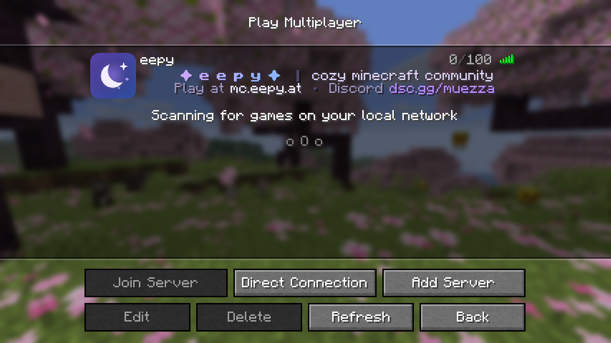
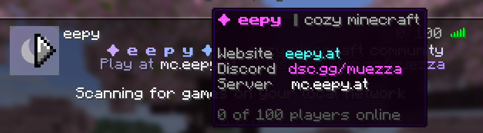
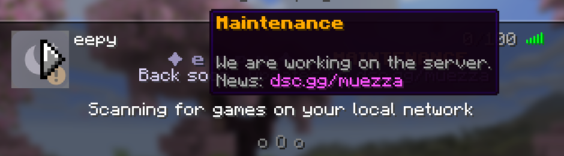

<div align="center">

# ✦ EepyMOTD

**A polished server list presence for the eepy Minecraft server.**

Violet-to-blue MOTD designs, a helpful hover, seasonal events, a maintenance mode and server icons – made to match [EepyTab](https://github.com/1870s/EepyTab) on [mc.eepy.at](https://eepy.at).

[](https://github.com/1870s/EepyMOTD/actions/workflows/build.yml)
[](https://github.com/1870s/EepyMOTD/releases/latest)
[](https://papermc.io/)
[](https://adoptium.net/)
[](LICENSE)



<sub>Real screenshot: Minecraft 26.1.2 client (launched as a Fabric dev client) pinging a local Paper 26.1.2 test server running EepyMOTD. The entry name "eepy" is what the player typed in "Add Server".</sub>

</div>

---

## ✨ Features

- 🎨 **Designed for the two-line MOTD** – gradient title, short tagline, address and Discord. Lines are centred automatically and too-wide lines are reported on reload.
- 🔁 **Four rotation modes** – `STATIC`, `RANDOM`, `SEQUENTIAL` (per refresh or timed) and `SCHEDULED` (weekdays and times).
- 🎄 **Seasonal events** – Christmas, New Year and Halloween are preconfigured; add your own with any start and end. Events end by themselves.
- 🛠️ **Maintenance mode** – its own design, icon, hover and optional version label. Switch it by command or schedule windows. Blocking joins is a **separate opt-in**.
- 🖼️ **Server icons** – four bundled eepy icons; drop your own PNGs into a folder. They are validated, resized to 64×64 if needed and cached – never loaded per ping.
- 💬 **Hover info** – website, Discord and address under the player count, optionally followed by real (non-vanished) players.
- 🔢 **Honest player counts** – the online number is always real (vanished players can be excluded); only the shown slot count is configurable.
- 🧩 **Placeholders** – `{online}`, `{max}`, `{time}`, `{event_ends}` and more, plus server-wide PlaceholderAPI placeholders.
- ⚡ **Built for ping floods** – rendered results are cached by their inputs; 3000 pings averaged 38.8 µs each on the test server, TPS stayed at 20.

## 🖼️ Designs

All designs below are crops of real screenshots from the Minecraft 26.1.2 server list (top to bottom: `default`, `community`, `discord`, `website`, `event` during an active event, `christmas`, `newyear`, `halloween`, `summer`, `maintenance`).


| Hover (player count) | Maintenance hover |
|---|---|
|  |  |

The `default` design was chosen as the standard: the spaced, gradient **✦ e e p y ✦** title matches the EepyTab header, and line 2 gives the two things a new player needs – where to play and where the community is.

## 📦 Installation

1. Download `EepyMOTD-x.y.z.jar` from [**Releases**](https://github.com/1870s/EepyMOTD/releases/latest).
2. Put it into your server's `plugins/` folder (optionally with PlaceholderAPI).
3. Restart the server. Edit `plugins/EepyMOTD/config.yml` and run `/eepymotd reload`.

**Requirements:** [Paper](https://papermc.io/downloads/paper) 26.1.2 · Java 25

| Paper | Status |
|---|:---:|
| 26.1.2 | ✅ tested on a live server and with the real 26.1.2 client |
| 26.2, 26.3 | ⚙️ compiles against the API (checked weekly by CI), not play-tested |

## 🎮 Commands & permissions

Alias: `/emotd`. All permissions default to op; `eepymotd.admin` grants all of them.

| Command | Permission | Description |
|---|---|---|
| `/eepymotd` | – | Plugin info and the design currently shown |
| `/eepymotd help` | – | Lists the commands you can use |
| `/eepymotd reload` | `eepymotd.reload` | Reloads config.yml and icons; a broken file is rejected and the old config stays active |
| `/eepymotd set <design>` | `eepymotd.set` | Always show one design |
| `/eepymotd random` | `eepymotd.set` | Show a random design from `rotation.pool` |
| `/eepymotd mode <mode>` | `eepymotd.set` | `static`, `random`, `sequential` or `scheduled` |
| `/eepymotd reset` | `eepymotd.set` | Back to the rotation from config.yml |
| `/eepymotd preview [design]` | `eepymotd.set` | Shows a design and its hover in chat |
| `/eepymotd maintenance [on\|off]` | `eepymotd.maintenance` | Shows or toggles the maintenance MOTD |
| `/eepymotd debug` | `eepymotd.debug` | Current selection, events, icons, ping timings, cache stats |

Choices made with `set`, `random`, `mode` and `maintenance` are saved in `data.yml` and survive restarts.

**Which design is shown?** Maintenance › active event › command choice › rotation mode.

## ⚙️ Configuration

Everything lives in [`config.yml`](src/main/resources/config.yml), which is commented section by section. Texts use [MiniMessage](https://docs.advntr.dev/minimessage/format.html) (gradients, hex colours, bold, ...); classic codes such as `&d&l` or `&#B98CFF` work too.

| Section | What it controls |
|---|---|
| `branding` | Server name, IP, website, Discord |
| `palette` | Colour tags shared with EepyTab: `<primary>`, `<secondary>`, `<muted>`, ... |
| `layout` | Centring, usable line width (≈270 px), classic colour codes |
| `designs` | Two-line designs, each with optional `icon` and `hover` |
| `rotation` | Mode, static design, pool, sequential interval, schedule |
| `events` | Seasonal and community events with start/end, designs, icon, priority |
| `maintenance` | Design, icon, hover, version label, schedule, opt-in join block |
| `player-count`, `hover` | Shown slots, hidden counts, vanished players, hover lines |
| `icons` | Default icon, resizing |
| `placeholders` | Time zone, formats, PlaceholderAPI refresh |
| `performance`, `compatibility`, `messages` | Cache size, listener priority, all command messages |

### Example design

```yaml
designs:
  default:
    line1: "<gradient:#C9A6FF:#8DB6FF><bold>✦ e e p y ✦</bold></gradient>  <line>│</line>  <text>cozy minecraft community</text>"
    line2: "<muted>Play at</muted> <highlight>{ip}</highlight>  <line>•</line>  <muted>Discord</muted> <primary>{discord}</primary>"
```

### Example event

```yaml
events:
  christmas:
    enabled: true
    name: "Christmas"
    start: "12-18"          # MM-dd = every year, yyyy-MM-dd = once; optional " HH:mm"
    end: "12-27"            # an end date without time includes the whole day
    designs: [christmas]    # several designs = random pick
    icon: eepy-winter
    priority: 10            # the highest active event wins
```

## 🔣 Placeholders

| Placeholder | Value |
|---|---|
| `{online}` / `{max}` | Real online count (optionally without vanished players) / shown slot count |
| `{server}` `{ip}` `{website}` `{discord}` | From `branding` |
| `{version}` | The server's Minecraft version |
| `{time}` `{date}` `{weekday}` `{year}` | Local time in `placeholders.timezone` |
| `{event}` `{event_ends}` | Name and remaining time (e.g. `2d 5h`) of the active event; empty otherwise |
| `{maintenance_ends}` | Time left in a scheduled maintenance window, otherwise `soon` |
| `%placeholder%` | PlaceholderAPI, **server-wide placeholders only** |

A server list ping has no player, so player placeholders such as `%player_name%` cannot work there. PlaceholderAPI values are refreshed on the main thread every `refresh-seconds` (default 10) and served from a cache, because many expansions are not safe to call from the network thread that handles pings. Missing or unknown placeholders show `missing-value`.

## 🛠️ Maintenance mode

- `/eepymotd maintenance on` switches to the `maintenance` design, the `eepy-maintenance` icon and the maintenance hover. The state is saved in `data.yml`.
- `maintenance.schedule` activates it automatically between `start` and `end` (`yyyy-MM-dd HH:mm`).
- `maintenance.version-label` (e.g. `&6⚠ Maintenance`) replaces the ping bars with text. The client then also treats the server as an incompatible version, so this is off by default.
- **By default nobody is kicked or blocked.** Set `maintenance.block-joins.enabled: true` to refuse joins while maintenance is active. Operators (`bypass-ops`) and the names/UUIDs in `bypass-players` can still join. Permissions can't be used for the bypass because the check runs before the player exists.

## 🖼️ Server icons

- On first start the bundled icons are copied to `plugins/EepyMOTD/icons/`: `eepy`, `eepy-maintenance`, `eepy-winter`, `eepy-halloween`.
- Add your own `name.png` files and reference them by `name` in `icons.default`, a design, an event or maintenance. Use `server` to keep the normal `server-icon.png`.
- Files are checked on load: PNG only, at most 2 MB and 2048×2048 px. Other sizes are scaled to 64×64 (`icons.resize`). Broken files are skipped with a warning and the default icon is used.
- Icons are loaded once per reload and handed to pings as cached objects.

The bundled icons are drawn by [`tools/make_icons.py`](tools/make_icons.py).

## ⚠️ Known limitations

- **Two lines, ~270 px each.** The vanilla client wraps longer lines and hides everything after line 2. Widths are estimated from the default font; resource packs or "Force Unicode Font" change them, so centring is close but not pixel-exact for every setup.
- **Hover lines support only the 16 classic colours.** The client shows them as legacy text, so hex colours are reduced to the nearest classic colour.
- **Bold Unicode symbols** (e.g. `❄`, `☀`) look blurry in the vanilla font, so the bundled designs keep them non-bold.
- **No animations.** The client fetches the MOTD only when the list is opened or refreshed, so animated MOTDs are not possible. Rotation modes change the design between refreshes instead.
- **Player placeholders** don't work in the ping (see above).
- **Other MOTD plugins** (MiniMOTD, ServerListPlus, ...) also edit the ping. EepyMOTD warns at startup; the plugin with the later `compatibility.listener-priority` wins.

## 🧠 Technical notes

- `PaperServerListPingEvent` is handled on Netty threads. The handler reads only immutable snapshots: the config/runtime (swapped atomically on reload), the persisted state and player sets sampled on the main thread every 2 s (only when needed).
- Designs are compiled once per reload (`{placeholders}` and `%papi%` become private MiniMessage tags). A render is cached by design, hover and all dynamic values, so repeated pings cost one map lookup.
- Placeholder values are inserted as plain text and are never parsed as MiniMessage, so they can't inject formatting.
- Hover lines use zero UUIDs, so tools and clients can tell them apart from real players. Real names are filtered against the live online list, because Paper caches its player sample for a few seconds.
- If anything fails during a ping, the event is left untouched (vanilla MOTD) and the error is logged at most once a minute.

## 🔨 Building

```bash
./gradlew build
```

The jar is written to `build/libs/EepyMOTD-<version>.jar`. Gradle downloads a Java 25 toolchain if needed. To target another Paper version, change `paperApiVersion` and `apiVersion` in `gradle.properties`.

## 📄 License

[MIT](LICENSE)
